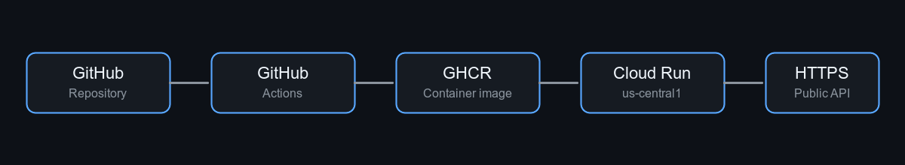
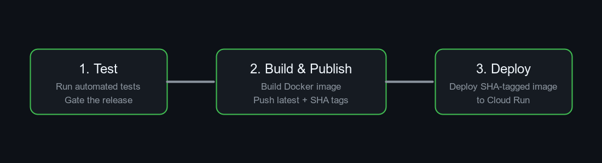

# Cloud Run Showcase

[](https://github.com/prakhar-thecoder/cloud-run-showcase/actions/workflows/deploy.yml)

A production-grade serverless deployment showcase: a containerized HTTP API tested, published, and deployed to Google Cloud Run through GitHub Actions.

## Live deployment

- **Service:** [https://cloud-run-showcase-240730567588.us-central1.run.app/](https://cloud-run-showcase-240730567588.us-central1.run.app/)
- **Interactive API docs:** [https://cloud-run-showcase-240730567588.us-central1.run.app/docs](https://cloud-run-showcase-240730567588.us-central1.run.app/docs)

The root endpoint exposes deployment metadata, including the deployed commit, commit message, source commit URL, and build timestamp.

## Delivery pipeline

### Deployment architecture



### CI/CD stages



The workflow runs on pushes to `main` and can also be started manually. Each stage must succeed before the next one begins.

## Image and release strategy

The public container image is published at:

```text
ghcr.io/prakhar-thecoder/cloud-run-showcase
```

Every build publishes two tags:

- `latest` — points to the newest successful build
- `sha-<short-sha>` — immutable identifier for a specific source revision

Cloud Run deploys the SHA-tagged image rather than `latest`, making every running revision reproducible and traceable to GitHub.

## Production-grade features

- Keyless GitHub-to-Google authentication using Workload Identity Federation
- 3-staged pipeline - separate test, build/publish, and deploy stages
- Immutable image-based deployments

## Run locally

```bash
python3 -m venv .venv
source .venv/bin/activate
pip install -r requirements-dev.txt
python -m pytest -q
uvicorn app.main:app --reload
```

Or run the production container locally:

```bash
docker build -t cloud-run-showcase:local .
docker run --rm -p 8080:8080 cloud-run-showcase:local
```

The local service is available at <http://localhost:8080>.

## Future improvements

- Include a Web Page showing revision history to visitors
- Staging and production environments
- Cloud Run revision traffic splitting and deployment approvals
